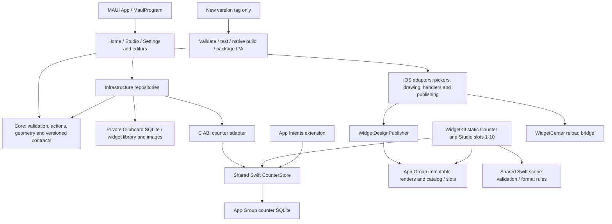

# Control Studio architecture audit

Audit date: 28 October 2026. Baseline: `5ed5904`, main, version 0.2.42 (44), clean working tree. The initial audit authorized local improvements only. The owner subsequently authorized committing, pushing main and pushing the new version tag for release 0.2.43 (45); native/device verification remains pending.

## Scope and evidence

Inventoried all 353 tracked files, scanned the tracked text/configuration, and traced the production entry points, persistence, editor lifecycle, rendering, native boundaries, resources and release scripts. Reviewed test coverage and ran the complete available baseline: Core 255, Infrastructure 96, App 407, Python packaging 50 (808 total); source checks passed. Native execution and physical-device profiling are unavailable on this Windows machine. A passing source guard is not a native runtime test.

There are six C# projects. The app is built in C#, not XAML; there is no Shell routing or ViewModel layer. The native Swift package has storage/contract tests and Objective-C adapter tests. The generated Xcode project is an intentional, tracked reproducible build input.

## Dependency map

Project references are acyclic: App -> Infrastructure -> Core; tests depend on the layers they exercise. The App test assembly links portable UI sources because the shipping app targets iOS. Test compilation is therefore not a substitute for compiling all platform files. DI is the composition root for long-lived services; child pages use explicit construction. Handler access to logging services is limited platform glue, not hidden business-service lookup.

The pragmatic split fits this local application. Replacing it with a new Clean Architecture/MVVM framework would add migration risk without demonstrated value. `WidgetEditorPage` (681 baseline lines), `WidgetCanvasView` and `ClipboardPage` have substantial orchestration responsibilities; focused extraction during future changes is preferable to a wholesale rewrite.

## Findings and decisions

### A01 — Source validation modifies the file it is checking

- Severity: **Medium**. Category: build tooling / working-tree safety.
- Files: `scripts/check-source.py`, `scripts/generate-xcode-project.py`.
- Evidence: the checker reads the original project, calls `generator.generate()` (which writes the project), then asserts equality. A stale project is overwritten even though validation fails. The initial `ROOT.rglob("*.csproj")` also traverses ignored SDK/build trees before excluding their files.
- Correction: add a read-only generator check; prune ignored directories before enumeration; test both stale and missing outputs without modifying them.
- Benefit: preserve developer edits and reduce unnecessary directory traversal. Baseline wall times for three consecutive warmed source-check runs: **1.077 / 0.989 / 0.937 seconds**. Re-measure after the fix; this is developer tooling, not app startup.
- Risk: low; generated bytes and normal generator behavior must remain identical.
- Status: implemented; final verification is in the optimization report.

### A02 — Profile persistence errors escape the save event and can leave false saved state

- Severity: **High**. Category: persistence / error handling / lifecycle.
- Files: `AppearancePreferences.cs`, `Views/ProfileEditorPage.cs`.
- Evidence: `SaveProfile` changes `PhotoKey`/`DisplayName` before either preferences write succeeds. `ProfileEditorPage.SaveAsync` has no exception handling. If writes fail, Cancel can mistake an imported photo for the committed photo and retain it. If navigation fails after a successful save, both Back and Cancel remain disabled by `saved`.
- Correction: publish in-memory state only after writes succeed; handle save/close failures; retain retryable draft controls before commit and allow Back/Cancel to retry dismissal after commit without repeating the save.
- Benefit: no unhandled button-task failure; truthful recovery and photo ownership.
- Risk: low to medium; explicitly test failures on both keys, success, invalid input, dismissal failure and departure. Existing preferences remain two independent keys; this is not a crash-atomic two-key transaction.
- Status: implemented; final verification is in the optimization report.

### A03 — Profile import duplicates the shared bounded image reader

- Severity: **Low**. Category: duplication / import validation.
- Files: `Platforms/iOS/ProfilePhotoStore.cs`, `ClipboardPhotoStore.cs`, `PhotoImportInput.cs`.
- Evidence: Profile repeats the same 8KB-buffer/10MB loop used by the shared input helper; Clipboard and Widget already use that helper. The Files branches do not mirror the Photo Library branches' conditional FileResult disposal.
- Correction: use `PhotoImportInput` for Profile and consistent conditional disposal for picked Files results. Keep format, crop, dimensions, compression, destinations and permissions.
- Benefit: one tested encoded-input limit across all imports. No measured decode-speed claim.
- Risk: low; empty imports receive the shared actionable error earlier.
- Status: implemented; final verification is in the optimization report.

### A04 — CI downloads NuGet packages without using its existing lock files for caching

- Severity: **Low**. Category: build performance.
- Files: `.github/workflows/test.yml`, `.github/workflows/build-ios.yml`.
- Evidence: both workflows use pinned setup-dotnet, but leave its package cache disabled; all six projects have committed lock files.
- Correction: enable setup-dotnet NuGet caching keyed by those lock files. Do not cache workloads, compiled native products, signing material, profiles or keychains. Preserve every validation step and the tag-only IPA trigger.
- Benefit: reuse package downloads on eligible cache hits. CI time savings require a future run; not measured locally.
- Risk: low; locked restores remain authoritative. See the [pinned action documentation](https://github.com/actions/setup-dotnet/blob/26b0ec14cb23fa6904739307f278c14f94c95bf1/README.md#caching-nuget-packages).
- Status: implemented; final verification is in the optimization report.

### A05 — Obsolete internal dashboard helpers

- Severity: **Low**. Category: confirmed unused code.
- Files: `Views/DashboardStyle.cs`, `StudioContent.cs`, `StudioContentTests.cs`.
- Evidence: `DashboardStyle.Card` has no references anywhere in tracked source, tests, docs or resource/configuration files. `StudioContent.ClipboardDraft` is an internal forwarding wrapper used only by tests; the real Clipboard editor already uses `Draft(..., ClipboardKind.Text, ...)`.
- Correction: remove the dead card factory and forwarding wrapper; retain the same behavioral assertions against the production Draft path.
- Benefit: remove stale alternatives without removing an application capability.
- Risk: low; neither is public, serialized, registered, reflected, native or resource-bound.
- Status: implemented; final verification is in the optimization report.

### A06 — Hidden live layers still form photo-group boundaries

- Severity: **Medium**. Category: rendering correctness / compatibility.
- Files: `Core/Widgets/WidgetClocks.cs` (`WidgetScenes.Steps`), `WidgetPhotoCompositor.cs`, saved scene contracts.
- Evidence: Steps flushes a photo group before checking a Clock/Date/Battery's visibility. A photo, hidden clock and Multiply photo are two separately rendered groups, so the Multiply photo cannot blend against the first group as it would with that clock removed. The existing Core test explicitly asserts this split.
- Recommendation: specify whether live layers isolate blend groups, then implement a versioned scene transition with old-scene/device regression coverage. Do not silently change grouping and invalidate already exported scenes during an unrelated cleanup.
- Benefit: predictable compositing when hiding layers; potentially fewer groups.
- Risk: **high** for unversioned changes to existing saved exports. Preserve current behavior in this audit and document the reproduction.
- Status: retained technical debt; no unverified rendering rewrite.

### A07 — Repeated publication and full editor composition need device measurements

- Severity: **Medium**. Category: UI / widget performance.
- Files: `Views/WidgetsPage.cs`, `Infrastructure/WidgetDesignPublisher.cs`, `Platforms/iOS/WidgetCompositeHandler.cs`, `WidgetPhotoCompositor.cs`.
- Evidence: My Widgets loads publish the entire catalog, validating/reading renders even when the destination immutable files exist; the editor composes on the UI thread on gestures/ticks. With 30 layers, the four-raster cache can thrash. Bounds already cap raster/source caches, graph depth, image bytes, scene pixels and visible saved previews.
- Recommendation: measure representative 1/10/30-layer gestures, one-second clock updates, 50-design publication and repeated navigation on the target phone. Consider revision-aware publication and static-group caching only after measuring and adding invalidation/ownership tests.
- Benefit: identify actual frame-time, memory and I/O bottlenecks.
- Risk: medium/high for speculative background rendering or cache changes, especially with UIKit thread affinity and Core Image wrapper aliasing. No unmeasured speedup or leak claim.
- Status: preserved pending profiling.

### A08 — Native transparency depends on private iOS 27 descriptors

- Severity: **High compatibility risk**, not a new confirmed failure. Category: native integration.
- Files: `native/WidgetRuntime/CSWidgetBackgroundAdapter.m`, related tests.
- Evidence: the working adapter hooks WidgetKit's private exported object and `CHSWidgetDescriptor`, checks ABI signatures, and limits installation to OS major 27. Public background modifiers alone did not meet the owner's device requirement.
- Recommendation: retain its narrow ABI checks/fallback and isolated target; retest each iOS update and before distribution-policy changes. Do not remove it as apparently unreferenced Objective-C.
- Benefit: preserve the device-confirmed behavior while acknowledging its compatibility risk.
- Risk: high if rewritten without a signed device build.
- Status: deliberately unchanged.

### A09 — Documentation describes the retired dashboard rather than today's app

- Severity: **Low**. Category: maintainability.
- Files: `docs/architecture.md`, `docs/known-limitations.md`, README repository overview, `Views/AboutPage.cs` instructions.
- Evidence: references to Run/Manage tiles, categories/favorites filtering and a Shortcuts tab no longer describe the current Studio/Clipboard UI. Native Widgets description mentions only the counter.
- Correction: update current architecture and repository overview; retain milestone/feature history as history.
- Benefit: future changes start from an accurate map.
- Risk: low.
- Status: implemented; final verification is in the optimization report.

## Dead-code/resource classification

| Class | Candidate/evidence | Decision |
|---|---|---|
| A: confirmed unused | DashboardStyle.Card; ClipboardDraft forwarding wrapper (only historical tests call it) | Remove narrowly; keep behavioral coverage |
| B: potentially unused | `IActionDefinition` has no consuming type in this repo; `IActionRepository.MoveAsync` is no longer called by current UI | Preserve public contracts and tested ordering behavior; no breaking API cleanup |
| C: dynamic/indirect | C ABI exports, Swift App Intent and Shortcuts provider, WidgetBundle/Studio 1-10, Objective-C selectors, SceneDelegate, handler registrations | Preserve; trace build/manifest/runtime registration rather than plain symbol counts |
| C: dynamic/resources | tab/theme/color-picker SVGs become PNG resources; system/custom font names; bundled TTFs and OFL licences | Preserve; names, registration and font hashes are validated |
| D: required | generated Xcode project, lock files, contracts, privacy manifests, three entitlements, legacy retired-size/schema readers and exact diagnostics cleanup | Preserve; generated does not mean disposable; compatibility does not mean dead |

No tracked IPA, compiled DLL/PDB/archive, provisioning profile, certificate or key was found. Ignored local SDKs, tools, artifacts and scratch investigation files are outside the shipped source; do not delete the owner's local tooling to make the inventory smaller. No whole source/resource file or package has been proven safe to delete.

## Coverage of the requested review areas

| Area | Assessment |
|---|---|
| Architecture, DI, MVVM, coupling, folder/naming consistency | Acyclic three-layer references; explicit constructor composition; code-built pages; large orchestration files noted. Keep current folders. No new framework or interfaces justified. |
| SQLite lifecycle, queries, transactions, indexes, migration | Single bounded dashboard document, one counter row: primary keys suffice; no N+1 queries. Bound user SQL parameters, short-lived handles, 3s busy timeout, serialized mutations/rollback. Existing migration/concurrency tests pass; no schema/index change justified. |
| Private widget storage and App Group publication | Private source of truth, optimistic revisions, atomic catalog writes, immutable render keys, sources retained while referenced. Shared catalog/slots are separate atomic files, not one cross-file transaction; native readers tolerate missing assignments rather than substitute designs. No format/signing changes. |
| Async, cancellation, lifecycle | No blocking .Result/.Wait found in production. Native counter mutations do not report cancellation after commit. Editor operation guards and page epochs prevent most duplicate/stale updates; profile gap A02. Other event async-void boundaries generally catch internally. |
| Memory, UI and accessibility | Bounded render caches and viewport image loading, refcounted battery observation, handlers/gestures/notifications released, Reduce Motion/Transparency paths. Clipboard uses CollectionView. No device heap/FPS claims; VoiceOver and scaled layout require device checks. |
| Swift, WidgetKit, App Intents and native bridge | Shared CounterStore and scene validation, explicit C string allocation/free, guarded ABI hooks, correct extension embedding and metadata checks. Static slot design intentionally retained after signing-service selector failures. No continuous widget polling. |
| Security, privacy and error handling | HTTP(S)-only URL validation rejects credentials/control characters; asset keys/path guards, bounded imports/catalogs/scenes, prepared SQLite, no telemetry. Long-press link preview is user-initiated network access. App Group provider container is shared with other entitled apps; app-specific path is not an isolation boundary. |
| Build, CI, dependencies and resource size | Pinned SDK/workload/Xcode/MAUI and SHA-pinned Actions, locked packages, deliberate font copies in two processes, tag-only IPA. A01/A04 improve tooling; no native/toolchain upgrade justified by this audit. |
| Tests and regression protection | Core/SQLite/serialization/lifecycle behavioral coverage is substantial. Packaging string guards cannot establish UIKit/SwiftUI execution. Large PickerCancellationTests mixes unrelated UI regressions; split by feature when its fixtures are extracted without losing coverage. |
| Backup/recovery/extensibility | Invalid/future stores are preserved; there is no general user-visible backup/restore product feature. Designing one is a separate feature, not part of cleanup. Maintain old contracts until explicit migrations are tested. |

## Dependency audit

Direct shipping package: Microsoft.Maui.Controls 10.0.110; Core/Infrastructure have no external runtime PackageReference. Native code uses Apple system frameworks and SQLite, with no CocoaPods/external Swift package. Test dependencies are the test SDK, xUnit/runner, and the pinned MAUI assemblies needed for portable UI tests. No proven unused dependency was removed.

NuGet's vulnerability feed was queried with `dotnet list ControlStudio.sln package --vulnerable --include-transitive --no-restore --format json`: successful exit, all six projects enumerated, **no vulnerable packages reported**. This is a point-in-time advisory check, not a guarantee that all code is secure. The initial restricted-network attempt failed DNS; the authorized network retry succeeded. MAUI's [package page](https://www.nuget.org/packages/Microsoft.Maui.Controls) advertises a newer patch; upgrade separately with the matched iOS workload and device regression checks, rather than mixing it into this audit.

See [optimization report](architecture-optimization-report.md) for final changes, commands/results and the device verification list.
